## Project Discontinuation

>
> I've decided to step away from this project due to the lack of interest and the criticism I've received for using AI as a development aid. I've invested a huge amount of time and effort into this project, and unfortunately, it has become difficult to justify continuing to maintain it under these circumstances.
>
> The latest released version is **1.1.0**, which fixes several issues. I hope all sports will now display correctly. However, if any of the sports APIs change in the future, I will no longer be releasing updates to address those changes.
>
> If anyone is interested in taking over, feel free to fork the project and continue its development. As for me, this is where I step away.
>
> I'd like to thank the few users who appreciated the project and gave it high ratings. Your support meant a lot to me.
>
> Thank you.

# Sports Widget for KDE Plasma 6

Sports widget for KDE Plasma desktop environment. Provides live scores, results, schedules and tables for various sports.

### Why this widget?
*   **Multi-Sport:** Follow 13 sports at the same time - Football, Basketball, Cricket, Tennis, American Football, Baseball, Ice Hockey, Racing, MMA, Rugby, Australian Football, Lacrosse and Volleyball.
*   **Multi-Competition:** Track several leagues, cups, national teams and favorite clubs together.
*   **Modern UX:** A clean, native-feeling interface with a guided setup wizard, live score panel and informative tooltip.
*   **Stay Notified:** Optional desktop notifications and Plasma calendar sync for the matches you care about.
*   **Network Friendly:** Smart refresh keeps schedules up to date every 30 minutes and live scores every 60 seconds, without hammering the data providers' APIs.

## 📑 Table of Contents
- [📦 Installation](#-installation)
  - [🛍 Install from KDE Store](#-install-from-kde-store-recommended)
  - [🛠 Manual Installation](#-manual-installation-development)
- [🖼️ Screenshots](#-screenshots)
- [✨ Detailed Features](#-detailed-features)
- [🏅 Supported Sports & Competitions](#-supported-sports--competitions)
- [🌐 Translation](#-translation)
- [📚 External Resources](#external-resources)
- [🐛 Bug Reports & Feedback](#-bug-reports--feedback)
- [❤️ Support](#-support-the-project)
- [📜 License](#-license)
- [™️ Trademark Notice](#-trademark-notice)

---

---

# 📦 Installation


## ⚠️ Prerequisites & Dependencies
For the full functionality of this widget, please ensure you have the following Qt6 modules installed for your distribution:

### 📡 Sports Details
*Required for the interactive Details tab (Chromium-based).*

| Distribution | Package Name |
|---|---|
| **Fedora / RHEL** | `qt6-qtwebengine` |
| **openSUSE** | `qt6-webengine` |
| **Arch Linux** | `qt6-webengine` |
| **Debian / Kubuntu / KDE Neon** | `qml6-module-qtwebengine` |

> **Note:** After installing these, restart your session or run `systemctl --user restart plasma-plasmashell`.

## 🛍 Install from KDE Store (Recommended)
1. Right-click your Panel or Desktop.
2. Select **Add Widgets...** -> **Get New Widgets** -> **Download New Plasma Widgets**.
3. Search for **Sports Widget**.
4. Click **Install**.

## 🛠 Manual Installation (Development)
If you prefer to install from source:
```bash
git clone https://github.com/pnedyalkov91/sports-widget-for-plasma.git && cd sports-widget-for-plasma
kpackagetool6 --type Plasma/Applet --install .
rm -rf ~/.cache/plasmashell/qmlcache
systemctl --user restart plasma-plasmashell
```

To update an existing installation, replace `--install` with `--upgrade`.

---

# 🖼️ Screenshots

<p align="center">
  <b>Live Matches</b><br>
  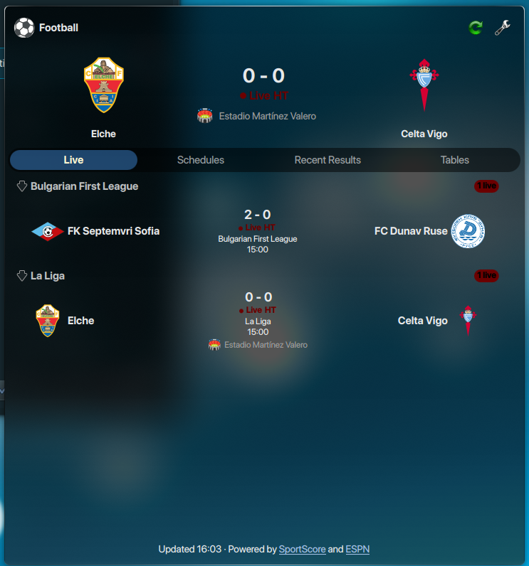
  <br>
  (Follow live matches with expandable details, lineups and tracker.)
</p>

<p align="center">
  <b>Schedules &amp; Recent Results</b><br>
  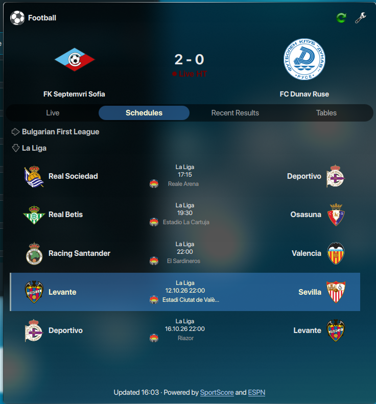
  
  <br>
  (Upcoming fixtures and recent results, with detailed stats per match.)
</p>

<p align="center">
  <b>Tables</b><br>
  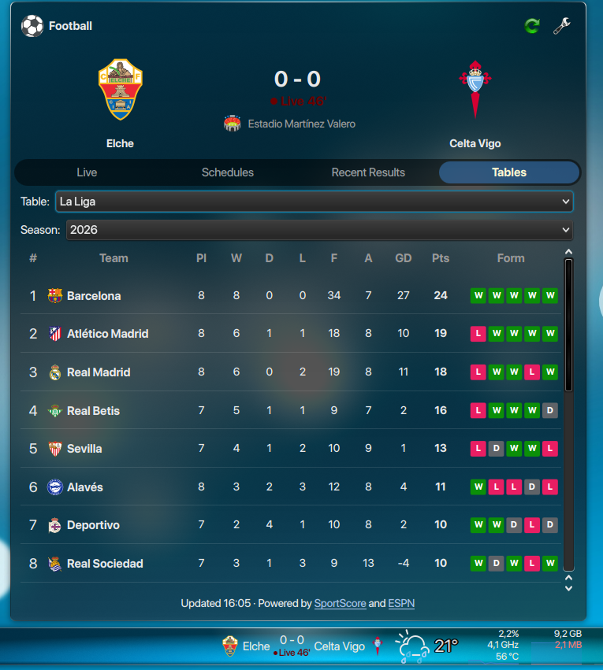
  <br>
  (League standings/group tables for your selected competitions.)
</p>

<p align="center">
  <b>Multiple Sports</b><br>
  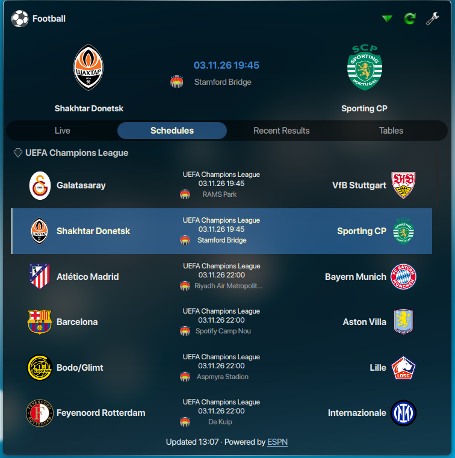
  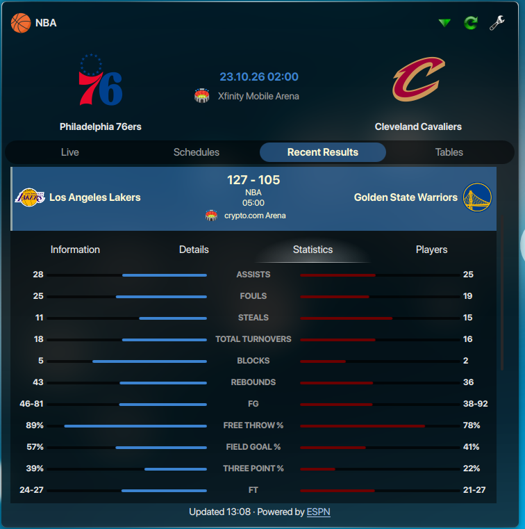
  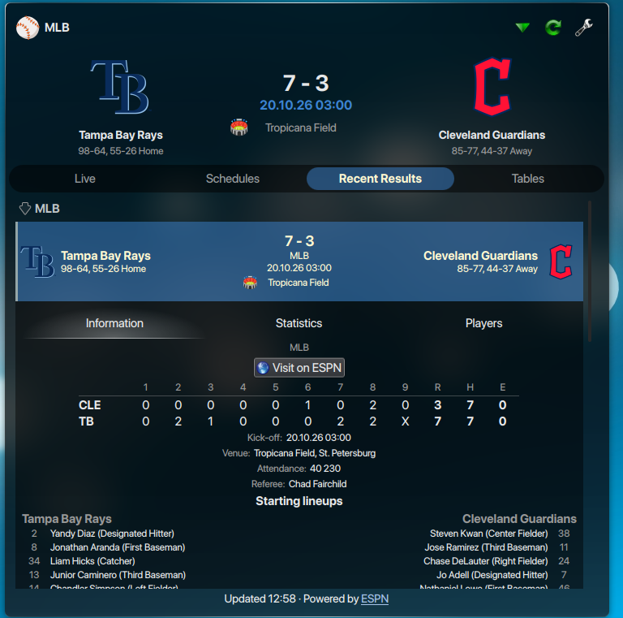
  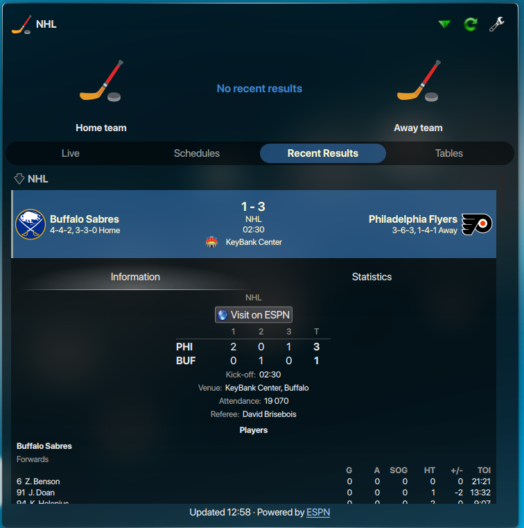
  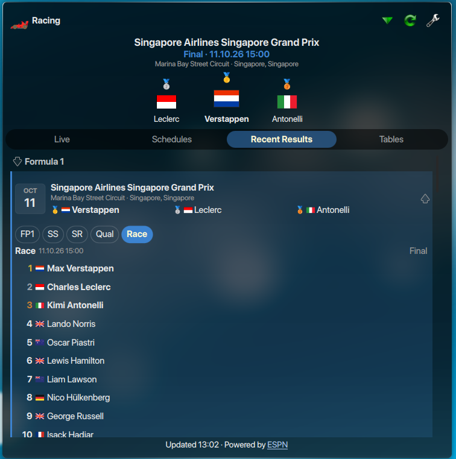
  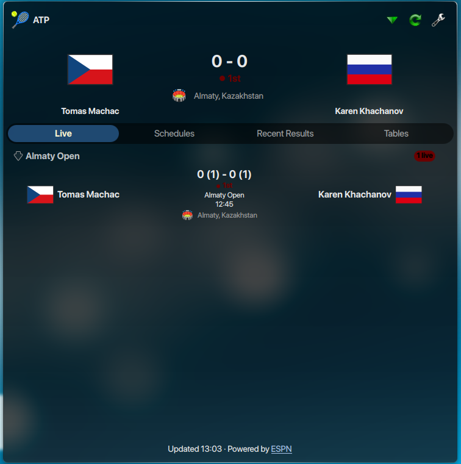
  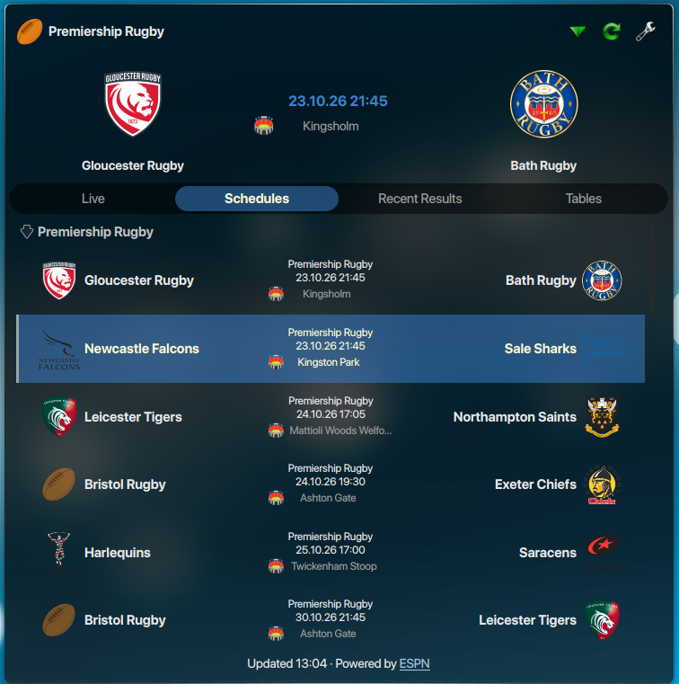
  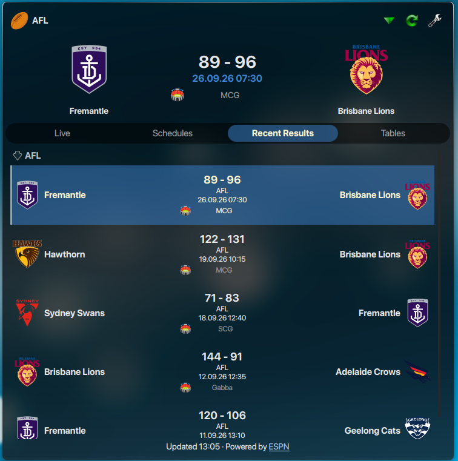
  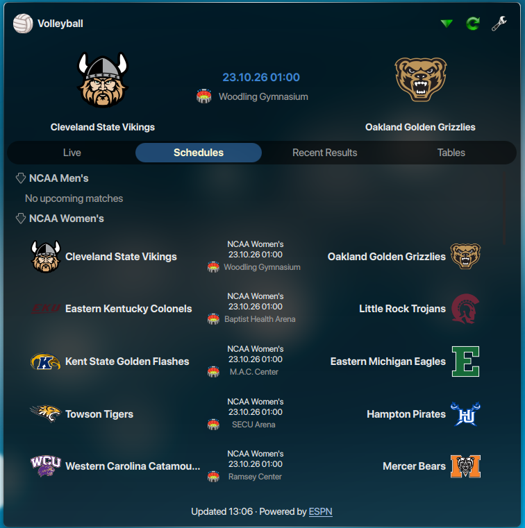
  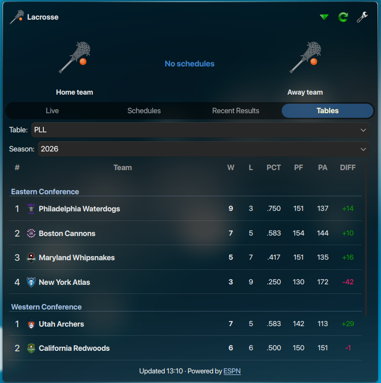
  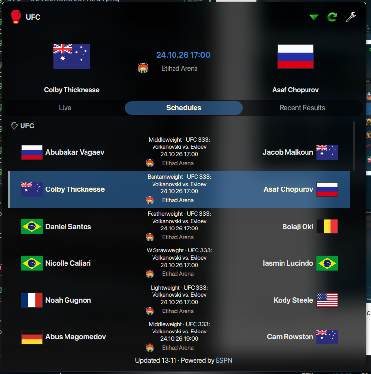
  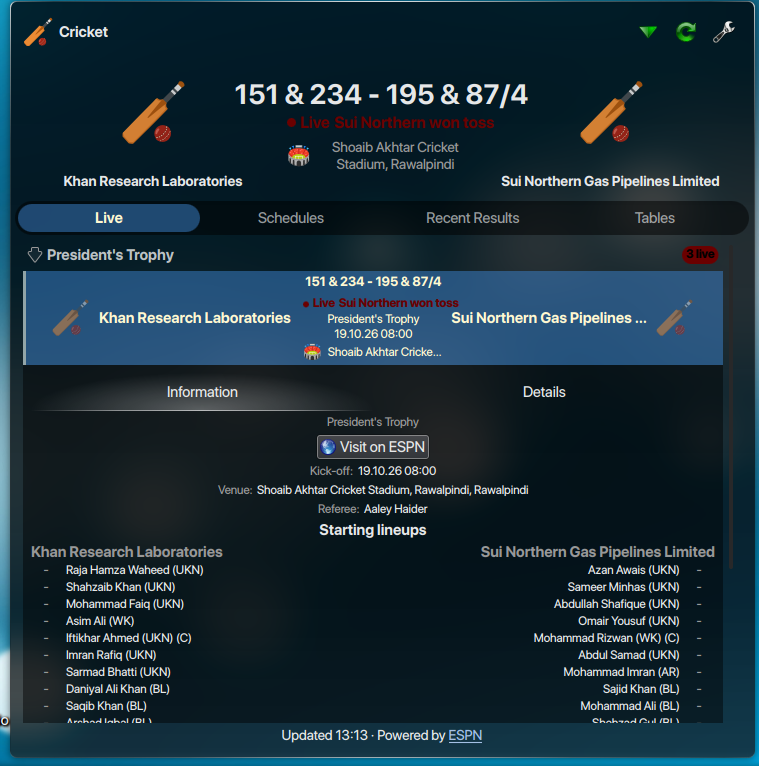

  <br>
  (Football, Basketball, Cricket and Tennis are supported alongside 9 more sports.)
</p>

<p align="center">
  <b>Tooltip and panel</b><br>
  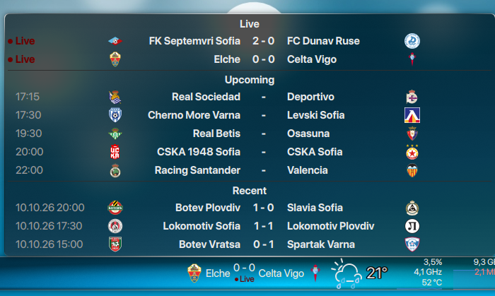
  <br>
  (Tooltip with upcoming and live matches.)
</p>

# ✨ Detailed Features

### 🏆 Sports & Competitions
- **Supported sports:** Football (FIFA, UEFA, CONMEBOL, Concacaf, CAF and AFC tournaments plus domestic leagues and cups from dozens of countries), Basketball (NBA, WNBA, NCAA, NBL, FIBA World Cup, Olympics), Cricket (ICC World Cup, T20 World Cup, IPL, Big Bash, PSL, SA20, The Hundred and more), Tennis (ATP, WTA), American Football (NFL, NCAA, CFL, UFL, XFL), Baseball (MLB, College Baseball, World Baseball Classic and more), Ice Hockey (NHL, NCAA, World Cup of Hockey, Olympics), Racing (Formula 1, NASCAR, IndyCar), MMA (UFC, PFL, Bellator), Rugby (Premiership, URC, Six Nations, Rugby World Cup, Super Rugby Pacific, MLR, Rugby League), Australian Football (AFL), Lacrosse (PLL, NCAA, NLL) and Volleyball (NCAA). See [Supported Sports & Competitions](#-supported-sports--competitions) for the full list.
- **Guided setup wizard:** Add a sport, then pick a country/competition or an international tournament, and optionally a favorite club, national team or player.
- **Multiple selections:** Add as many sports, competitions, national teams and favorite teams as you like - they're all combined into one view, with duplicate detection so you don't add the same thing twice.
- **International tournaments:** Follow World Cups, continental championships and other international competitions without picking a specific country.
- **Favorite team highlighting:** Matches involving your favorite teams are prioritized and visually highlighted across all tabs.

### 📺 Live Scores & Match Details
- **Live tab:** See all live matches for your selected sports/competitions at a glance, grouped by competition.
- **Match details:** Click a live match to expand inline details (score progression, current period/set, etc.).
- **Schedules tab:** Upcoming fixtures for your selected competitions and teams.
- **Recent Results tab:** Latest finished matches and final scores.
- **Tables tab:** League standings/tables for your selected competitions, with season selection where available.
- **Quick actions:** Star, bell and pin icons on each match row let you favorite a team, get notified about that match, or pin it to the panel with one click.
- **Widget layout:** Choose between a Detailed view (featured match, tabs, standings, recent results) or a Simple view (a single scrolling list of live and upcoming matches), and pick which tabs are visible.

### 🔔 Notifications
- **Desktop notifications:** Get notified on kickoff, goals/score changes, half-time, full-time, and detailed events (scorer, cards, substitutions - football only).
- **"Starting soon" reminders:** A heads-up a configurable number of minutes before kickoff.
- **Per competition/team control:** Notifications are off by default and can be turned on individually for each followed competition or team, or limited to favorite teams only.
- **Per-match notifications:** Use the bell icon on any match to get notified just for that one game.

### 📅 Calendar Integration
- **Plasma calendar sync:** Upcoming fixtures from your followed competitions and teams appear directly in the Plasma calendar (the date/clock pop-up), via a native calendar plugin.
- **.ics export:** Optionally also export a standard iCalendar file you can import into any calendar app (Google Calendar, Thunderbird, GNOME, mobile, etc.).
- **Per competition/team control:** Like notifications, calendar sync is off by default and can be enabled per followed competition or team.

### 🔄 Smart Refresh
- **Smart mode (default):** Automatically checks for upcoming matches every 30 minutes and refreshes live scores every 60 seconds while a match is in progress - keeping data fresh while minimizing network requests.
- **Manual mode:** Turn off Smart refresh to set your own "Full refresh" (minutes) and "Live refresh" (seconds) intervals, or disable separate live updates entirely.

### 🖥 Panel Integration
- **Panel modes:** Detailed (shows the live/upcoming match) or Simple (a compact live/remaining match count, similar to GNOME's Colosseum).
- **Panel layouts:** Show emblems + teams + score, emblems + score only, or teams + score only.
- **Panel sizing:** Auto-fit, fill the panel, or set a manual size for team emblems.
- **Custom fonts:** Use the system font or pick your own family, size and weight for the panel text.
- **Match rotation:** Automatically rotate through multiple live/upcoming matches in the panel (and in the widget's hero area), with a configurable interval.

### 🛈 Tooltip
- Hovering the panel icon shows a quick tooltip with your live and upcoming matches, so you don't need to open the full widget.

### 🎛 Customization
- **National teams visuals:** Display national teams using emblems/flags.
- **Date & time formats:** Multiple built-in formats (e.g. `22.05`, `22.05.2026`, `2026-05-22`, `22 May`, region defaults, or 12/24-hour clock times) or fully custom Qt date/time patterns, with a live preview.

---

# 🏅 Supported Sports & Competitions

Click a sport to expand its list of competitions. Additional competitions that are not listed here may be offered by the widget when they are currently running (for example, new cricket series and tours are added live).

<details>
<summary><b>⚽ Football</b></summary>

**International & qualifying**
- **FIFA:** FIFA World Cup, FIFA Women's World Cup, FIFA Under-20 World Cup, FIFA Under-17 World Cup, FIFA Under-17 Women's World Cup, FIFA Club World Cup, FIFA Intercontinental Cup, FIFA Women's Champions Cup, Olympics Men's Football, Olympics Women's Football
- **Friendlies:** International Friendly, Women's International Friendly, U21 International Friendly, U20 International Friendly, SheBelieves Cup
- **World Cup qualifying:** World Cup Qualifying, World Cup Qualifying - UEFA / CAF / AFC / Concacaf / CONMEBOL / OFC, Women's World Cup Qualifying - Playoff, Women's World Cup Qualifying - UEFA
- **UEFA:** UEFA Champions League, UEFA Champions League Qualifying, UEFA Europa League, UEFA Europa League Qualifying, UEFA Conference League, UEFA Conference League Qualifying, UEFA Super Cup, UEFA Women's Champions League, UEFA European Championship, UEFA European Championship Qualifying, UEFA Women's European Championship, UEFA European Under-21 Championship, UEFA European Under-21 Championship Qualifying, UEFA European Under-19 Championship, UEFA Nations League, UEFA Women's Nations League
- **Concacaf:** Concacaf Champions Cup, Leagues Cup, Concacaf Gold Cup, Concacaf Nations League, Concacaf W Gold Cup, Concacaf W Champions Cup
- **CONMEBOL:** CONMEBOL Libertadores, CONMEBOL Sudamericana, CONMEBOL Recopa, Copa America, Copa America Qualifying, Copa America Femenina
- **CAF:** Africa Cup of Nations, Africa Cup of Nations Qualifying, CAF Champions League, CAF Confederation Cup
- **AFC:** AFC Champions League Elite, AFC Champions League Two, AFC Asian Cup

**Europe**
- **England:** Premier League, EFL Championship, EFL League One, EFL League Two, National League, FA Cup, EFL Cup (Carabao Cup), EFL Trophy, FA Community Shield, Premier League Asia Trophy, Women's Super League, Women's FA Cup, Women's FA Community Shield
- **Spain:** La Liga, La Liga 2, Copa del Rey, Supercopa de Espana, Trofeo Joan Gamper, Liga F, Copa de la Reina
- **Germany:** Bundesliga, 2. Bundesliga, DFB-Pokal, DFL-Supercup, Bundesliga Relegation Playoff, 2. Bundesliga Relegation Playoff
- **Italy:** Serie A, Serie B, Coppa Italia, Supercoppa Italiana
- **France:** Ligue 1, Ligue 2, Coupe de France, Trophee des Champions, Premiere Ligue (Women)
- **Netherlands:** Eredivisie, Eerste Divisie, Tweede Divisie, KNVB Beker, Johan Cruyff Shield, Vrouwen Eredivisie, KNVB Beker Vrouwen
- **Portugal:** Primeira Liga, Taca de Portugal
- **Scotland:** Scottish Premiership, Scottish Championship, Scottish League One, Scottish League Two, Scottish Cup, Scottish League Cup, Scottish Challenge Cup
- **Other European leagues:** Belgian Pro League, Austrian Bundesliga, Greek Super League, Turkish Super Lig, Danish Superliga, Norwegian Eliteserien, Swedish Allsvenskan, Cypriot First Division, League of Ireland Premier Division, Russian Premier League

**North & Central America**
- **USA:** Major League Soccer, U.S. Open Cup, NWSL, NWSL Challenge Cup, NWSL x Liga MX Femenil Summer Cup, USL Championship, USL League One, USL Super League, NCAA Men's Soccer, NCAA Women's Soccer
- **Canada:** Northern Super League
- **Mexico:** Liga MX, Liga de Expansion MX, Campeon de Campeones, Supercopa MX

**South America**
- Liga Profesional Argentina, Copa Argentina, Brasileirao Serie A, Brasileirao Serie B, Copa do Brasil, Primera Division Chile, Primera A Colombia, Primera Division Paraguay, Liga 1 Peru, Primera Division Uruguay, Liga Profesional Bolivia, LigaPro Ecuador, Primera Division Venezuela

**Africa**
- South African Premiership, Nigerian Professional League, Ghanaian Premier League

**Asia & Oceania**
- Saudi Pro League, Saudi King's Cup, J.League, Chinese Super League, Indian Super League, Thai League 1, Malaysian Super League, Indonesian Super League, Singapore Premier League, A-League Men, A-League Women

</details>

<details>
<summary><b>🏀 Basketball</b></summary>

NBA, WNBA, NBA G League, NCAA Men's, NCAA Women's, NBL, FIBA World Cup, Olympics Men's Basketball, Olympics Women's Basketball, NBA California Classic Summer League, Golden State Summer League, Las Vegas Summer League, Orlando Summer League, Sacramento Summer League, Salt Lake City Summer League

</details>

<details>
<summary><b>🏏 Cricket</b></summary>

- **International tournaments:** ICC Cricket World Cup, ICC Men's T20 World Cup, Africa Continental Cup, European T20 Premier League
- **Franchise T20 leagues:** Indian Premier League, Women's Premier League, Big Bash League, Women's Big Bash League, Pakistan Super League, SA20, International League T20, Caribbean Premier League, Women's Caribbean Premier League, Bangladesh Premier League, The Hundred Men's Competition, Major League Cricket
- **Domestic competitions:** County Championship Division One, Marsh Sheffield Shield, Syed Mushtaq Ali Trophy, CSA 4-Day Series Division 1, SLC T20 League, ECB Women's One-Day Cup
- Bilateral tours and one-off series that are currently running are added automatically.

</details>

<details>
<summary><b>🎾 Tennis</b></summary>

ATP, WTA

</details>

<details>
<summary><b>🏈 American Football</b></summary>

NFL, NCAA Football, CFL, UFL, XFL

</details>

<details>
<summary><b>⚾ Baseball</b></summary>

MLB, College Baseball, World Baseball Classic, Caribbean Series, NCAA Softball, Dominican Winter League, Little League Baseball, Little League Softball, Mexican League, Olympics Men's Baseball, Puerto Rican Winter League, Venezuelan Winter League

</details>

<details>
<summary><b>🏒 Ice Hockey</b></summary>

NHL, NCAA Men's Hockey, NCAA Women's Hockey, World Cup of Hockey, Olympics Men's Ice Hockey, Olympics Women's Ice Hockey

</details>

<details>
<summary><b>🏎 Racing</b></summary>

Formula 1, NASCAR Cup Series, NASCAR O'Reilly Auto Parts Series, NASCAR Truck Series, IndyCar

</details>

<details>
<summary><b>🥊 MMA</b></summary>

UFC, PFL, Bellator MMA

</details>

<details>
<summary><b>🏉 Rugby</b></summary>

Premiership Rugby, United Rugby Championship, Six Nations, Rugby World Cup, Super Rugby Pacific, Major League Rugby, Rugby League

</details>

<details>
<summary><b>🏉 Australian Football</b></summary>

AFL

</details>

<details>
<summary><b>🥍 Lacrosse</b></summary>

PLL, NCAA Men's, NCAA Women's, NLL

</details>

<details>
<summary><b>🏐 Volleyball</b></summary>

NCAA Women's, NCAA Men's

</details>

---

## 🌐 Translation

The widget follows your system language automatically. It currently ships with English, Italian and Bulgarian translations, and more are welcome - see the [translation guide](translate/readme.md) for how to contribute a new one.

## 🐛 Bug Reports & Feedback
If you encounter any issues or have suggestions, please open a [GitHub Issue](https://github.com/pnedyalkov91/sports-widget-for-plasma/issues). Please include your distribution, Plasma version, and the sport/competition you were viewing.

## External resources

- All sports (Football, Basketball, Cricket, Tennis, American Football, Baseball, Ice Hockey, Racing, MMA, Rugby, Australian Football, Lacrosse and Volleyball) are sourced from ESPN's public (unofficial, undocumented) endpoints, in the same way as the [Public-ESPN-API](https://github.com/pseudo-r/Public-ESPN-API) reference project.
- [SportScore](https://sportscore.com/) is used for **Football only**, as a supplementary source for the leagues that ESPN's unofficial API doesn't support.

---

## 📜 License

This project is licensed under the **GNU General Public License v2.0 or later**.

---

## ™️ Trademark Notice

All product names, logos, trademarks and registered trademarks referenced in this project are the property of their respective owners and are used solely for identification purposes. Reasonable care has been taken to spell, capitalize and attribute these names accurately. Use of these names does not imply any affiliation with or endorsement by their respective owners. This project is not affiliated with, endorsed by, or sponsored by SportScore, ESPN, or any of the sports leagues, federations, clubs or organizations referenced within it.
